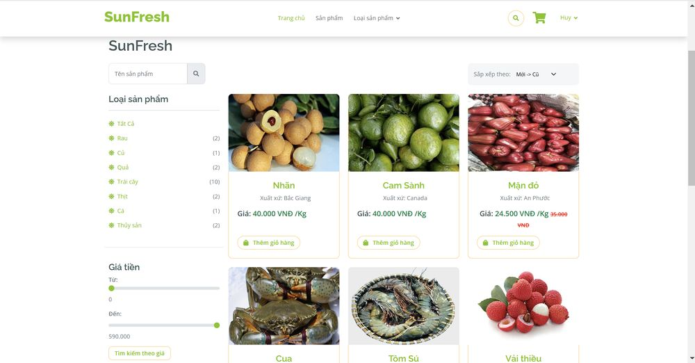
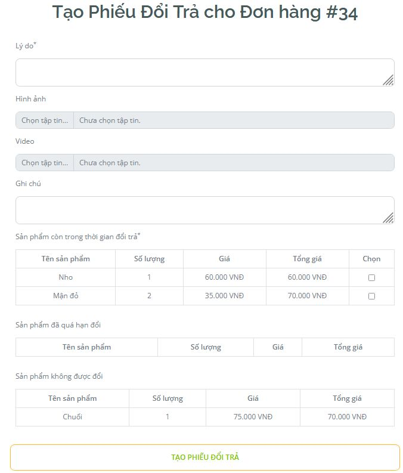
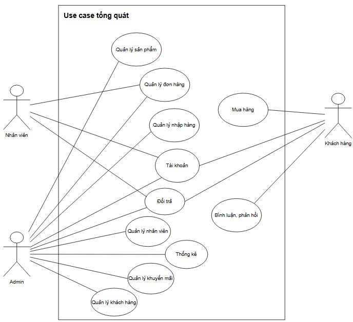
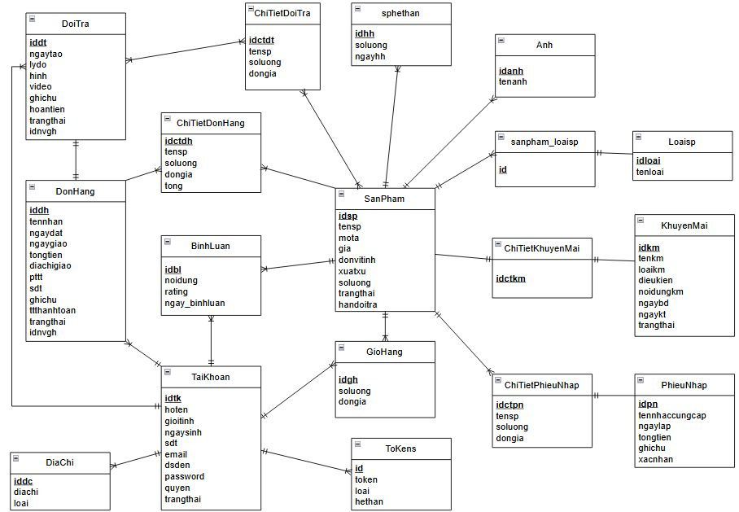
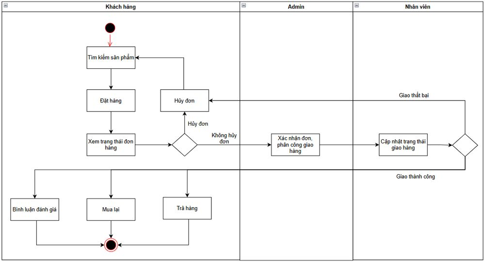

# SunFresh: Agricultural Products E-commerce Website

An online store for clean agricultural products (vegetables, fruit, meat, seafood), built as a university capstone project. The focus of the project is **requirements analysis and system design**: from business analysis, use cases and process flows to database design and a working Laravel web application.

> Course project at Ho Chi Minh City University of Industry and Trade (HUIT), supervised by Phan Thi Ngoc Mai. Team of 3.



## At a glance

| | |
|---|---|
| User roles | 3 (Admin, Staff, Customer) |
| Functional modules | 11 |
| Use case specifications | 19 |
| Use case diagrams | 11 |
| Activity diagrams | 19 |
| Sequence diagrams | 19 |
| Database tables | 18 |
| Payment | VNPay (online, with OTP verification) and cash on delivery |

## Features

### Customer
- Register with email activation (activation link expires after 60 minutes), log in, reset password, change email, edit profile, manage delivery addresses
- Browse products by category, search by name, filter by price range, sort by newest/oldest
- Cart, checkout with shipping fee based on distance, promotion applied to the cart
- Pay online with VNPay (OTP verification) or cash on delivery; order confirmation email
- Order history and order details, cancel an unconfirmed order, **reorder** a previous order
- **Return request**: choose the items to return, give a reason with images and video; items outside the return window or not returnable are shown separately
- Rate and comment on products

### Staff
- Process orders through the lifecycle: pending, packing, shipping, delivered
- Update delivery status; pick up returned goods and complete refunds

### Admin
- Manage products (add/edit with image upload), customers and staff (search, sort, lock/unlock accounts)
- Manage promotions and apply them to the cart
- Goods receipt (import notes) with automatic stock update, out-of-stock and near-expiry notifications
- Assign deliveries; review and approve return requests
- Role-based permission management
- Revenue statistics by day, week, month and year; best-selling and highest-profit products; Excel export



## Business rules (examples)

| Rule | Value |
|---|---|
| Product price | Must be a multiple of 1,000 VND |
| Product name | Must be unique |
| Product image | Up to 2 MB |
| Return window | 0 to 7 days after delivery |
| Account activation link | Expires after 60 minutes |
| Cancel an order | Only while it is not yet confirmed |
| Return an order | Only when the status is "delivered successfully" |

## System analysis and design

The analysis package covers the full path from business need to implementation:

1. **Requirements**: functional and non-functional requirements for the three roles and 11 modules
2. **Use cases**: 11 use case diagrams and 19 detailed specifications (priority, preconditions, main and alternative flows, postconditions)
3. **Business processes**: registration/login and the ordering process
4. **Behavior models**: 19 activity diagrams and 19 sequence diagrams
5. **Database design**: ERD, CDM and a data dictionary for 18 tables (types, keys, constraints)

| Use case overview | ERD |
|---|---|
|  |  |



## Tech stack

- **Backend:** PHP, Laravel (MVC, routing, Blade templates, middleware)
- **Database:** MySQL
- **Frontend:** HTML, CSS, JavaScript, Bootstrap
- **Payment:** VNPay sandbox
- **Modeling:** UML (use case, activity, sequence), ERD/CDM

## Getting started

> Adjust these steps to match the repository (database dump or seeders, PHP version, VNPay and mail settings).

```bash
# 1. Clone the repository
git clone <repository-url>
cd <project-folder>

# 2. Install dependencies
composer install

# 3. Configure the environment
cp .env.example .env
php artisan key:generate
# Set DB_DATABASE, DB_USERNAME, DB_PASSWORD in .env
# Set the mail settings (activation and order emails) and the VNPay sandbox keys in .env

# 4. Create the database and tables
php artisan migrate --seed

# 5. Run the application
php artisan serve
```

Open `http://127.0.0.1:8000` in your browser.

## Team and my contribution

| Member | Role |
|---|---|
| **Pham Minh Nhut** | Business analysis, database analysis and creation, project planning and task assignment, plus the features listed below |
| Nguyen Nhat Linh | Authentication, account, order management, returns and reorder, expiry notification and stock deduction |
| Lu Gia Huy | CDM, staff and customer management, order history, promotions, goods receipt, permissions, VNPay payment, testing |

**What I did:**
- Led the business analysis for both the admin site and the customer site, planned the project and split tasks across the team
- Analyzed the database and created the MySQL tables with primary keys, foreign keys and constraints
- Built product management (add and edit), the customer product browsing pages and the purchase (checkout) flow
- Built product reviews and comments
- Built revenue statistics and best-selling product reports
- Extended promotion management and added applying promotions to the cart

## Lessons learned

- Writing use case specifications with exact preconditions and alternative flows first made implementation and testing much easier
- Business rules (price format, return window, expiry of links) are best written down early, because they decide validations in several modules
- Splitting work by module only works when the data model is agreed first

## License

This project was created for educational purposes.
